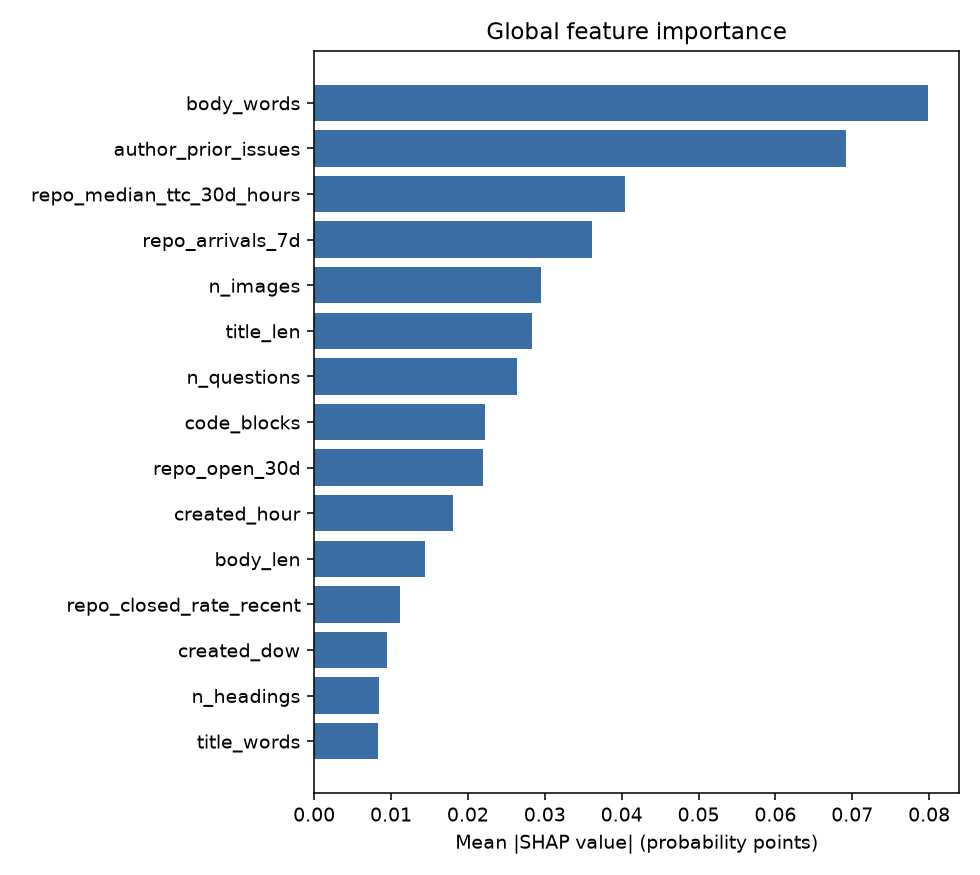

# gh-issues-triage

Predicts, **at the moment a GitHub issue is opened**, whether maintainers will close it within 14 days. Trained on issues from large Google-backed open-source repositories, served through a validated FastAPI endpoint, and monitored for data and performance drift.

> Status: collecting on a schedule since Oct 20, 2026. **First real-data results (Oct 23, 2026) are in the [Results](#results) section**, with their caveats.
>
> **Live page:** [krisrchesney.github.io/gh-issues-triage](https://krisrchesney.github.io/gh-issues-triage/), with open issues most likely to stall plus a weekly out-of-time replay of the model's accuracy. Rebuilt after each collection run by `.github/workflows/pages.yml`.

## Why this project

Issue queues are ticket queues. The question "which new tickets are likely to stall?" is the same one a support or engineering team asks at intake, and public issue trackers give a free, continuously updating, auditable dataset (full history, so no waiting weeks to start).

## How it works

```
GitHub REST API --collect--> Parquet lake (data/raw/gh_issues/dt=YYYY-MM-DD)
                                   |  synced to an orphan `data` branch by scripts/data_sync.sh
                                   v
                 build (leak-free labels + creation-time features) --> DuckDB
                                   v
        train: logistic baseline vs HistGradientBoosting vs LightGBM  (MLflow)
                                   v
              models/<version>/ + model card  -->  FastAPI /predict /explain
                                   v
        drift: PSI per feature + live AUC after the training cutoff --> retrain flag
```

## Leakage and bias controls (the part worth reading)

Most "predict ticket outcome" projects quietly cheat. This one is built so it cannot:

| Risk | Control | Proof |
|---|---|---|
| Features that know the future (comments, labels, state, closed_at) | Explicit feature allowlist in `config.yaml`; post-creation columns are stored for analysis but blocked | `test_no_post_creation_column_is_a_feature`, `test_config_feature_list_matches_code` |
| Context features using later events | Every context feature uses only facts true strictly before the issue was opened | `test_no_future_information_leaks_into_features` truncates the world to the issue's creation moment and requires identical features |
| Right-censoring | Issues younger than the 14-day horizon are excluded **even if already closed**; otherwise fast closers would be over-represented | `test_build_excludes_issues_younger_than_horizon_even_if_closed` |
| Survivor bias from the backfill window | Issues created before `coverage_start` are dropped before any feature is computed; a 30-day warm-up is skipped | `test_build_respects_coverage_and_warmup` |
| Edited titles/bodies | Text statistics are frozen at first sight and never overwritten | `test_updates_replace_rows_but_keep_the_first_seen_snapshot` |
| Titles renamed during triage | "First sight" can be late: the initial backfill saw issues weeks after they were opened, and 9.5% of those 4,525 titles had already been rewritten by maintainers (Go 13%). Renamed issues close half as often, so a rewritten title leaks the outcome. Each backfilled issue's title at creation was recovered from GitHub's `renamed` events (`gh_titles` lake source) and all title features use it. Issues collected since Oct 20, 2026 are first seen within about 6 hours, so a small exposure remains for very fast renames. Bodies cannot be recovered this way and keep the same, smaller caveat. | `test_a_later_rename_cannot_change_title_features`, `test_original_titles_replace_renamed_ones_and_their_counts` |
| Random splits leaking time | Time-ordered holdout (newest 20%) | `test_time_split_never_leaks_future` |
| Monitoring on training data | Drift and live AUC use only rows newer than the training cutoff | `test_monitoring_window_only_contains_rows_after_the_training_cutoff` |

## Privacy and data handling

- Issue **bodies are never stored**: text is reduced to counts (length, code blocks, links, stack-trace flag...) at ingest.
- Author ids are **salted and hashed**; no usernames are kept. Use a private `GH_AUTHOR_SALT` secret (see Setup).
- Only public data from public repositories is used. Respect GitHub's terms and rate limits.

## Setup

Requires Python 3.11+.

```bash
python -m venv .venv && source .venv/bin/activate
pip install -e ".[dev]"
pytest                                            # includes a no-network end-to-end run
export GITHUB_TOKEN=...                           # fine-grained token, public repo read only
export GH_AUTHOR_SALT="$(openssl rand -hex 16)"   # keep this value forever
python -m ghtriage.github_issues check-repos      # confirm each repo exists and is busy
python -m ghtriage.cli collect gh_issues          # first run backfills from coverage_start (resumable)
python -m ghtriage.cli build && python -m ghtriage.cli train
python -m ghtriage.cli drift && python -m ghtriage.cli explain
python -m ghtriage.cli serve                      # http://localhost:8000/docs
```

The first backfill is capped at `max_pages_per_repo` pages per repo per run; re-run until it reports `0 inserted` (the cursor lives in the lake, so it resumes automatically).

## Decisions and tradeoffs

- **Label = closed within 14 days, any reason.** Cheap to compute from the list endpoint (time-to-first-response would need one extra request per issue, which the 1,000 requests/hour Actions budget cannot afford). The cost: "closed" mixes completed, duplicate and not-planned.
- **Issues created before `coverage_start` are not stored.** The builder would drop them anyway, so keeping them only grows the data branch. A small `gh_state` progress marker keeps resumption correct when whole pages are skipped.
- **Pull requests are fetched and discarded.** The issues endpoint returns both and cannot filter them server-side, so PR-heavy repos spend pages on rows that are thrown away.
- **Counts instead of text.** Privacy and storage win; a language model on the text is the obvious next step and is not included.
- **The baseline must be beaten.** Logistic regression stays champion unless a challenger gains at least 0.01 ROC AUC.
- **DuckDB + Parquet, not a warehouse.** Free and local; no managed-warehouse experience is claimed.
- **Known collection gap.** Position-based pagination can skip an issue at a page boundary if an older issue is updated mid-run; expect a few missing rows per large backfill. Skips are unrelated to the outcome, so bias is negligible.
- **Collection bug found and repaired (Oct 2026).** GitHub's `sort=updated` list is not strictly ordered: during the flutter/flutter backfill, one item reported an `updated_at` two weeks ahead of its neighbours. The collector resumed from the newest value it had seen, so a capped run skipped every issue last updated between Aug 26 and Sep 9, 2026: 237 of 2,135 flutter issues created since `coverage_start`, 155 of them closed. That gap was **not** random with respect to the label. A check against GitHub's search counts found the other three repositories complete. Capped runs now resume from the median of their last page. The window was re-fetched with a one-off `github.rewind` entry (run on Oct 23, 2026: 237 issues restored). A re-check against GitHub's search API then found 0 of 4,648 issues created Jul 1 - Oct 21, 2026 missing in any of the four repositories, and 0 stored states differing from GitHub.

## Results

**First real run: Oct 23, 2026** (model `v20261023T030552Z`). 2,983 labelled issues from angular, flutter, golang and tensorflow, created Jul 31 to Oct 9, 2026 (after the 30-day warm-up; every issue at least 14 days old). Time-ordered split: trained on 2,386 issues up to Sep 26, tested on the newest 597 (Sep 26 to Oct 9). Closed within 14 days: 47.3% in training, 40.9% in test.

| Model | ROC AUC | Avg precision | Brier | ECE |
|---|---|---|---|---|
| Logistic baseline | 0.641 | 0.497 | 0.240 | 0.109 |
| **HistGradientBoosting (champion)** | **0.665** | **0.645** | **0.221** | **0.093** |
| LightGBM | 0.653 | 0.639 | 0.233 | 0.127 |

- The signal is modest. A bootstrap of the test set (2,000 resamples) puts the AUC gain over the baseline at -0.008 to +0.055 (95%): likely, not proven, at this sample size.
- **A weekly replay is less flattering (added Oct 26, 2026).** Retraining for each week on only the outcomes known before it began, then scoring that week's issues, gave the model (LightGBM, the champion that day) a mean ROC AUC of 0.655 over the four weeks Sep 14 to Oct 11 (1,305 issues) vs 0.657 for the logistic baseline. Week to week the two trade places (model 0.495 to 0.721, baseline 0.538 to 0.702). On this evidence the model does not beat the baseline; the single test split above overstated the gain. The live page reruns this replay every 6 hours.
- **Fixes tested on the same replay (Oct 27, 2026; 1,305 issues, Sep 14 to Oct 11).** Removing the renamed-title leak barely moved accuracy (model ROC AUC 0.656 to 0.654), so earlier results were not materially inflated. New title signals and project indicators gave 0.661 vs the baseline's 0.658: within week-to-week noise, so they are kept but not claimed as an improvement. Calibration was the real gain: Platt scaling learned on the latest 25% of each training window and applied to a model refitted on all rows left the ranking unchanged and cut the expected calibration error from 0.106 to 0.030 (Brier 0.239 to 0.231). It is now on (`model.calibration: sigmoid`). The same approach did not work for the CVE project, where the probabilities stay uncalibrated.
- **Champion now chosen over rolling folds (Oct 28, 2026); the logistic baseline is deployed.** Picking on the single newest-20% split flipped between near-tied tree models: across 7 snapshots that each dropped the newest 0 to 6 days, it chose hist_gbm 5 times and LightGBM twice (3 changes). Scoring each candidate on 4 consecutive blocks inside the training window instead (each predicted by a model fitted on everything before it) chose the logistic baseline in all 7 snapshots: mean ROC AUC 0.665 vs 0.648 (hist_gbm) and 0.643 (LightGBM) on the current data. That agrees with the weekly replay, so the deployed model is now the calibrated logistic regression. The test-split table above is kept for the record; on that one split the trees looked better.
- Per repository, the champion beats the baseline on golang (0.64 vs 0.54) and angular (0.68 vs 0.48, only 50 issues), but not on flutter (0.66 vs 0.68) or tensorflow (0.54 vs 0.57, 38 issues).
- Probabilities run high (ECE 0.09), partly because the 14-day close rate fell from 47% to 41% between the training and test periods.
- Most important features (mean |SHAP|): body_words, author_prior_issues, repo_median_ttc_30d_hours, repo_arrivals_7d, n_images.



- Drift (PSI): the four repository-level context features are flagged (PSI 1.6 to 2.9). Each repository's value barely moves inside a two-week window, so this reflects the short window, not a broken input; per-issue features are stable (max PSI 0.14). No issue created after the training cutoff has a final label yet, so "live" AUC currently equals the test AUC.
- This run used the repaired data described under "Collection bug found and repaired".

## Limitations

- Closed-for-any-reason label; no distinction between resolved and dismissed.
- Context features start empty at `coverage_start` (hence the warm-up).
- Trained on a few large repositories; transfer to small projects is untested.
- The `/explain` endpoint is slow on cold start (permutation SHAP) and needs the `explain` extra.

## Data source

Data from the GitHub REST API (public repositories).
